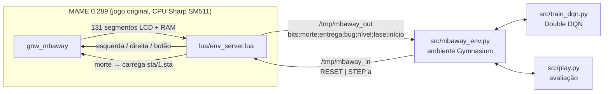

# Mario's Bombs Away: agente de Reinforcement Learning

Um agente **Double DQN** que aprendeu a jogar *Mario's Bombs Away* (Nintendo Game & Watch, 1983) no jogo original, emulado no MAME. Os inputs da rede são os segmentos do ecrã LCD e duas variáveis internas da RAM do chip.

O jogo não foi reimplementado. O agente carrega nos mesmos 3 botões que um humano (esquerda, direita, bomba) através de um script Lua dentro do MAME, que comunica com o Python por *named pipes*.

| | |
|---|---|
| Melhor vida registada | **44 bombas entregues** sem perder (~10 min de jogo) |
| Média em avaliação (ε = 0) | ~8–12 bombas por vida (avaliações de 10 episódios) |
| Rede | MLP 38 → 128 → 128 → 4 (22 020 parâmetros) |
| Treino | ~300 mil decisões, ~1 h 20 min num MacBook M2 |

---

## Índice

1. [Como funciona](#1-como-funciona)
2. [O problema de RL](#2-o-problema-de-rl)
3. [Estrutura da pasta](#3-estrutura-da-pasta)
4. [Instalação](#4-instalação)
5. [Passo a passo](#5-passo-a-passo)
6. [Como se encontraram as variáveis escondidas](#6-como-se-encontraram-as-variáveis-escondidas)
7. [Mapa de sinais (RAM e segmentos)](#7-mapa-de-sinais)
8. [Configuração](#8-configuração)
9. [Resultados e história do treino](#9-resultados-e-história-do-treino)
10. [Limitações e próximos passos](#10-limitações-e-próximos-passos)
11. [Problemas comuns](#11-problemas-comuns)

---

## 1. Como funciona



Há dois processos a correr ao mesmo tempo:

**MAME + `lua/env_server.lua`** (o "servidor" do ambiente). A cada frame, o script:
- lê os 131 segmentos do LCD (`root:output(nome)`) e alguns endereços da RAM do SM511;
- executa a ação recebida durante **8 frames** (*action repeat*, ~0,13 s de jogo);
- deteta **morte**, **entrega** e o **bug** da cutscene;
- na morte, carrega logo o checkpoint `sta/gnw_mbaway/1.sta` (início do Game B, com uma bomba na mão), no mesmo frame. Assim o Python não perde tempo à espera da animação;
- durante a animação de entrega (o jogo para e o Mario volta ao início) salta frames sozinho, até `MAX_SKIP = 300`, para o agente não "decidir" num momento em que nada responde;
- força a RAM `0x0B` a 3 em todos os frames (velocidade fixa, ver [secção 6](#6-como-se-encontraram-as-variáveis-escondidas)).

**Python** (`src/`). `mbaway_env.py` embrulha o protocolo numa API Gymnasium (`reset`, `step`). `train_dqn.py` treina e `play.py` avalia.

**Protocolo** (texto, uma linha por mensagem):

| Direção | Mensagem |
|---|---|
| Python → Lua | `RESET` ou `STEP <0-3>` (0 nada, 1 esquerda, 2 direita, 3 botão) |
| Lua → Python | `<131 bits>;<morte>;<entrega>;<bug>;<nível 0x0B>;<fase 0x0C>;<início>` |

O MAME tem de arrancar **primeiro**: o Lua cria os FIFOs e fica bloqueado à espera que o Python os abra.

---

## 2. O problema de RL

**Episódio = uma vida.** Começa no checkpoint do início do Game B e acaba na primeira bomba que explode na mão do Mario (o jogo original dá 3 vidas, aqui só há uma). No `reset` faz-se um número aleatório de 0 a 29 passos "nada", para desfasar os temporizadores do chip e não começar sempre no mesmo estado.

**Observação: 38 valores entre 0 e 1.**
- **36 segmentos do jogo** (`src/segments.py`): 15 tochas, 10 posições do Mario (2 colunas × 5 linhas), 4 do homem do charuto, 5 fogos no chão e 2 do homem final. Ficam de fora os 21 segmentos da pontuação, os dígitos e o resto da decoração.
- **Nível de velocidade**: RAM `0x0B`, normalizado. Com a velocidade fixa é constante, mas fica na entrada para se poder libertar a velocidade sem mudar a rede.
- **Fase do tick**: RAM `0x0C` / 5, quanto falta para o próximo "tick" do jogo. Sem isto a rede vê o ecrã mas não sabe *quando* as tochas se vão mexer.

**Ações:** nada, esquerda, direita e botão (sobe ou baixa a bomba).

**Recompensa:** o mínimo possível.

| Evento | Recompensa |
|---|---|
| Bomba entregue | +1 |
| Morte | −1 (e fim do episódio) |
| Cada decisão (também ficar parado) | −0,01 |
| *Shaping* por potencial | γ·Φ(s') − Φ(s), com Φ = 0,05 × linha do Mario (0..4) |

O *shaping* dá +0,05 por cada linha que o Mario avança e −0,05 por cada linha que recua. Por ser baseado em potencial, não muda a política ótima (Ng, Harada & Russell, 1999), só acelera a aprendizagem no início. O −0,01 por decisão nunca torna morrer preferível: ficar parado para sempre vale no limite −1, o mesmo que morrer, e o desconto γ = 0,99 já favorece entregas rápidas. A pontuação do jogo e as explosões de árvores são ignoradas.

**Algoritmo:** Double DQN (`src/train_dqn.py`). A rede online escolhe a melhor ação do estado seguinte e a rede *target* avalia-a, o que reduz a sobrestimação dos valores Q do DQN simples.

| Hiperparâmetro | Valor |
|---|---|
| Rede | MLP 38 → 128 → 128 → 4, ReLU |
| Replay buffer | 100 000 transições |
| Batch | 64, uma atualização por decisão |
| Warmup | 5 000 transições antes de treinar |
| Target sync | a cada 1 000 passos |
| Otimizador | Adam, lr 1e-4 (fase 1) |
| Loss | Smooth L1 (Huber), *gradient clipping* a 10 |
| γ | 0,99 |
| ε-greedy | 1,0 → 0,05 linear em 50 000 passos (fase 1); chão 0,01 na fase 2 |

Duas regras do buffer que importam:
- **Truncar não é morrer.** Quando um episódio chega ao limite de passos (`MB_MAX_STEPS`), as transições são guardadas com `done = False`. A rede continua a estimar o valor do estado seguinte em vez de aprender que "ali o jogo acaba".
- **Episódios com bug são descartados.** Se o segmento `1.15.1` acende, a deteção de morte falhou e a cutscene começou. As transições desse episódio não entram no buffer.

---

## 3. Estrutura da pasta

```
mame/
├── README.md
├── requirements.txt
├── .gitignore
│
├── lua/                      # scripts que correm DENTRO do MAME
│   ├── env_server.lua        #   o ambiente: ações, deteções, resets, FIFOs (treino e play)
│   ├── make_checkpoint.lua   #   cria sta/gnw_mbaway/1.sta (só é preciso uma vez)
│   ├── dump_ram.lua          #   investigação: grava segmentos + RAM a cada frame em CSV
│   └── poke_speed.lua        #   investigação: força 0x0B e mede a velocidade real
│
├── src/                      # Python
│   ├── mbaway_env.py         #   ambiente Gymnasium (observação, recompensa, shaping)
│   ├── segments.py           #   mapa dos segmentos LCD (tochas, Mario, ...)
│   ├── train_dqn.py          #   treino Double DQN
│   └── play.py               #   avaliação greedy (ε = 0)
│
├── data/
│   └── segnames.json         # nomes dos 131 segmentos LCD, pela ordem do protocolo
│
├── models/
│   ├── mario_dqn_final.pt    # modelo final (fase 2)
│   └── mario_dqn_fase1.pt    # modelo da fase 1 (ponto de partida da fase 2)
│
├── sta/gnw_mbaway/1.sta      # checkpoint do início do Game B (estado do MAME)
│
├── research/                 # como se encontraram 0x0B e 0x0C
│   ├── analyze_speed.py
│   ├── analyze_speed2.py
│   └── data/speed_session.csv
│
├── tests/
│   └── fake_mame.py          # testa o pipeline sem MAME (Lua real num MAME simulado)
│
├── roms/gnw_mbaway.zip       # a ROM, não incluída no repositório (direitos de autor)
├── cfg/                      # gerado pelo MAME
└── .venv/                    # ambiente Python
```

Os checkpoints de um treino novo vão para `checkpoints/`, criado automaticamente.

---

## 4. Instalação

Testado em macOS (Apple Silicon), MAME 0.289, Python 3.14 e PyTorch 2.14.

```bash
# 1. MAME
brew install mame

# 2. ROM: copia o teu gnw_mbaway.zip (romset do MAME) para roms/

# 3. Python
cd ~/mame
python3 -m venv .venv
source .venv/bin/activate
pip install -r requirements.txt
```

A rede é pequena e o gargalo é o emulador, por isso treina em CPU (não vale a pena MPS ou CUDA).

---

## 5. Passo a passo

Todos os comandos correm **a partir da pasta do projeto** (`~/mame`), porque os scripts Lua usam caminhos relativos a ela.

### 5.1 Checkpoint do início do Game B (já incluído)

O `sta/gnw_mbaway/1.sta` já vem no projeto. Só precisas disto se o quiseres regenerar (atenção: reescreve o ficheiro):

```bash
mame gnw_mbaway -autoboot_script lua/make_checkpoint.lua -autoboot_delay 3 -window
```

No MAME, carrega em **Game B** e joga. O script grava o estado no 3.º flanco de descida do segmento `1.0.2`, ou seja, quando o Mario recebe a bomba pela 3.ª vez (jogo a correr, bomba na mão). Depois congela e não volta a gravar.

### 5.2 Treinar do zero

Terminal 1 (MAME primeiro; a janela fica parada até o Python ligar):

```bash
mame gnw_mbaway -autoboot_script lua/env_server.lua -autoboot_delay 0 \
     -window -nothrottle -sound none
```

Terminal 2:

```bash
source .venv/bin/activate
python src/train_dqn.py                    # 300 000 passos por omissão
```

O `-nothrottle` põe o MAME a correr o mais depressa possível: ~64 decisões/s, ~26 min por 100 000 passos num M2.

A cada 10 episódios aparece uma linha como esta:

```
ep  3500 | step  198133 | eps 0.050 | entregas inicio(50) 2.30 | melhor 2.30 | ...
```

`entregas inicio(50)` é a média de bombas por vida nos últimos 50 episódios, ainda com exploração ε. O `best.pt` é guardado sempre que essa média bate o recorde. A cada 5 000 passos aparece também a distribuição das ações.

Ficheiros em `checkpoints/`: `best.pt`, `latest.pt`, `ckpt_<passo>.pt` (a cada 10 000) e `final.pt`.

### 5.3 Continuar o treino a partir de um modelo

O modelo guarda também o estado do otimizador, por isso dá para retomar. O buffer recomeça vazio.

```bash
MB_RESUME=models/mario_dqn_final.pt MB_CKPT_DIR=checkpoints_fase3 \
MB_EPS_START=0.01 MB_EPS_END=0.003 MB_EPS_DECAY=50000 \
MB_LR=3e-5 MB_STEPS=100000 python src/train_dqn.py
```

A fase 2 foi feita assim, a partir do `mario_dqn_fase1.pt`, com o chão de ε a 0,01.

### 5.4 Avaliar / ver a jogar

Para **ver** a jogar à velocidade real, corre o MAME sem `-nothrottle`:

```bash
mame gnw_mbaway -autoboot_script lua/env_server.lua -autoboot_delay 0 -window
```

Para **medir**, usa `-nothrottle` e pelo menos 30 episódios:

```bash
MB_EP=30 python src/play.py                          # modelo final
MB_EP=30 python src/play.py models/mario_dqn_fase1.pt
```

No fim aparece:

```
MEDIA: 9.80 entregas/episodio em 30 episodios (desvio ..., erro tipico ...) -> p por bomba ~ 0.91
```

`p por bomba` é a probabilidade estimada de entregar cada bomba. Se cada bomba for entregue com probabilidade p, a média de entregas por vida é p / (1 − p). Para uma média de 50 é preciso p ≈ 0,98.

Com ε = 0 a política é determinística. A variedade entre episódios vem só dos 0–29 passos "nada" no reset, por isso podem aparecer episódios repetidos.

### 5.5 Testar sem o MAME

```bash
pip install lupa
python tests/fake_mame.py train     # treino curto contra o env_server.lua num MAME falso
python tests/fake_mame.py play      # avalia o modelo final no MAME falso
```

Corre o `lua/env_server.lua` verdadeiro num interpretador Lua com um MAME simulado, pelos mesmos FIFOs. Serve para confirmar que o protocolo, os resets, o treino e o play funcionam depois de mexer no código. Os números que aparecem não significam nada.

---

## 6. Como se encontraram as variáveis escondidas

O ecrã não mostra tudo. O jogo tem uma velocidade que muda (acelera com as entregas) e um relógio interno que decide *quando* as tochas e os fogos avançam. Sem essa informação a rede vê uma fotografia e não sabe quanto tempo tem. O processo foi:

1. **Gravar.** `lua/dump_ram.lua` grava, a cada frame, os 131 segmentos e os 128 endereços de RAM do SM511 para um CSV, enquanto se joga à mão.
   ```bash
   mame gnw_mbaway -autoboot_script lua/dump_ram.lua -autoboot_delay 0 -window
   ```
2. **Procurar candidatos.** A primeira tentativa foi automática, com os scripts em `research/` (precisam de `pandas`):
   - `analyze_speed.py` mede o intervalo entre movimentos das tochas e procura o endereço que o explica;
   - `analyze_speed2.py` procura endereços que mudam pouco, junto das entregas, e acompanham o número de entregas da vida.

   ```bash
   python research/analyze_speed2.py research/data/speed_session.csv
   ```

   **Não foram conclusivos.** O piscar das tochas contava como movimento, e com poucas entregas por sessão a correlação aponta para endereços errados (no CSV incluído, o `0x0B` não aparece no topo). O `0x0B` foi encontrado a olhar diretamente para o CSV: é o endereço que desce um degrau (5 → 4 → 3) exatamente no fim de uma animação de entrega e fica constante entre entregas. A partir daí, o `0x0C` apareceu como o contador que desce de `0x0B` até 0 entre dois ticks.
3. **Provar causalidade.** Correlação não chega. `lua/poke_speed.lua` escreve um valor em `0x0B` a cada frame e mede o intervalo do tick. Com `0x0B = 3` o tick passou de ~28 para ~18 frames e o jogo ficou visivelmente mais rápido, o que prova que `0x0B` *controla* a velocidade.

Resultado:
- `0x0B` = **nível de velocidade**. Vale 5 no início (lento, tick de ~28 frames), 4 dá ~23 e 3 dá ~18; menor é mais rápido. Só muda no fim da animação de entrega.
- `0x0C` = **fase do tick**. Conta de `0x0B` até 0 entre dois ticks (~5 frames por unidade).

**Decisão:** a velocidade foi fixada em 3 (`FORCE_NIVEL = 3` no `env_server.lua`). Isto tira a parte do problema que vem de o jogo acelerar e deixa só "jogar bem a uma velocidade rápida". Com `FORCE_NIVEL = nil` a velocidade fica livre e o Lua guarda um checkpoint `lv<N>` da primeira vez que cada nível aparece. Os resets sorteiam entre o início e esses níveis, mas este modo não foi usado no modelo final.

Ficou por identificar o **temporizador das tochas**. Os fogos alinham com o contador de ticks `0x09` em 80–91 % dos casos, as tochas só em 29 %, por isso há outro relógio que a rede não vê.

---

## 7. Mapa de sinais

**RAM (SM511, endereços de 4 bits):**

| Endereço | Significado | Uso |
|---|---|---|
| `0x0B` | nível de velocidade (5 lento … 1 rápido) | entrada da rede; forçado a 3 |
| `0x0C` | fase do tick (conta de `0x0B` até 0) | entrada da rede |
| `0x2C` | passa a 15 na morte (~6 frames antes da animação) | deteção de morte |
| `0x5A` | contador da animação de entrega (0 = acabou) | checkpoints por nível |
| `0x09` | contador de ticks | investigação |
| `0x02` | contador 0–9 (volta ao fim de 6 entregas) | não usado |
| `0x03` | contador de passos | não usado |
| `0x1B`, `0x4E`, `0x4F`, `0x18`, `0x19` | relógios periódicos | não usados |

**Segmentos de controlo:**

| Segmento | Significado |
|---|---|
| `1.8.0` + `0.8.1` | entrega (Mario na última posição + homem final) |
| `0.10.0` (acende) | entrega confirmada → o jogo para (`game_stopped`) |
| `1.0.2` (apaga) | Mario recebe bomba nova → o jogo recomeça |
| `1.15.1` | cutscene de morte: a deteção falhou, o episódio é descartado |

Os 36 segmentos da observação estão em `src/segments.py`.

---

## 8. Configuração

**Python** (variáveis de ambiente, todas opcionais):

| Variável | Omissão | O que faz |
|---|---|---|
| `MB_STEPS` | 300000 | passos (decisões) de treino |
| `MB_LR` | 1e-4 | learning rate |
| `MB_EPS_START` / `MB_EPS_END` / `MB_EPS_DECAY` | 1.0 / 0.05 / 50000 | exploração ε-greedy |
| `MB_WARMUP` | 5000 | transições antes de começar a treinar |
| `MB_MAX_STEPS` | 5000 (treino), 20000 (play) | limite de passos por episódio |
| `MB_FRAME_STACK` | 1 | quantos ecrãs seguidos a rede vê (4 → 146 entradas) |
| `MB_SHAPING` | 0.05 | peso do shaping por posição (0 desliga) |
| `MB_CKPT_DIR` | `checkpoints` | onde guardar os modelos |
| `MB_RESUME` | — | modelo para retomar |
| `MB_EP` | 10 | episódios do `play.py` |
| `MB_SEGNAMES` | `data/segnames.json` | lista de segmentos |

`MB_FRAME_STACK` e `MB_SHAPING` mudam a observação ou a recompensa: não se pode retomar um modelo treinado com outros valores.

**Lua** (topo do `lua/env_server.lua`):

| Constante | Valor | O que faz |
|---|---|---|
| `FORCE_NIVEL` | 3 | velocidade fixa; `nil` liberta-a |
| `ACTION_REPEAT` | 8 | frames por decisão |
| `MAX_SKIP` | 300 | máximo de frames saltados na animação de entrega |
| `LOAD_FRAMES` | 12 | frames de espera depois de carregar um checkpoint |
| `P_INICIO` | 0.5 | só com velocidade livre: prob. de um reset ir para o início |

---

## 9. Resultados e história do treino

| Fase | Modelo | Passos | O que mudou | Média em treino (50 ep., com ε) |
|---|---|---|---|---|
| 1 | `mario_dqn_fase1.pt` | 198 133 (de 210 000) | treino do zero, ε final 0,05 | ~2,3 |
| 2 | `mario_dqn_final.pt` | +98 542 (de 100 000) | retomado da fase 1, chão de ε 0,01 | 5,38 |

A avaliação greedy (ε = 0) do modelo final dá ~8–12 bombas por vida, com cauda longa: o melhor episódio gravado teve **44 entregas**, ~10 min de jogo. Uma média de ~10 corresponde a p ≈ 0,91 por bomba. Falta uma avaliação com `MB_EP=30` para ter barras de erro limpas.

A diferença entre treino e avaliação é esperada: com ε = 0,05, 1 em cada 20 decisões é aleatória, e numa vida de centenas de decisões isso basta para morrer.

O que fez diferença, por ordem:
1. **Deteção limpa de morte e entrega** no Lua, com reset no próprio frame da morte. As primeiras versões perdiam mortes, e o agente aprendia com episódios errados.
2. **Fixar a velocidade e dar a fase do tick (`0x0C`) à rede.** Sem a fase a rede não sabe *quando* o perigo chega.
3. **Baixar o chão de exploração** de 0,05 para 0,01 na fase 2: a média em treino passou de ~2,2 para ~4–5.
4. **Não descartar episódios truncados.** Uma versão antiga deitava fora os episódios que chegavam ao limite de 2000 passos, ou seja, precisamente os melhores. Está corrigido no `train_dqn.py` atual. Os dois modelos incluídos foram treinados *antes* desta correção, por isso há margem para melhorar.

---

## 10. Limitações e próximos passos

- **Uma vida só e velocidade fixa em 3.** O jogo completo tem 3 vidas e acelera.
- **Temporizador das tochas por identificar** (ver [secção 6](#6-como-se-encontraram-as-variáveis-escondidas)). É provavelmente a informação que falta para passar de p ≈ 0,91 para p ≈ 0,98.
- **Episódios com bug são descartados** por inteiro. Seria melhor guardar as transições até pouco antes do `1.15.1` e marcar morte.
- **Avaliação com 30+ episódios e várias sementes** para comparar modelos com rigor.

Ideias de experiências:
- Q-learning tabular sobre a mesma observação;
- DQN vs Double DQN;
- DQN com a RAM inteira, com *permutation importance*, para ver que variáveis a rede realmente usa (pode revelar o temporizador das tochas);
- `MB_FRAME_STACK=4` e uma rede recorrente;
- CNN sobre a imagem do ecrã (~150×100).

---

## 11. Problemas comuns

| Sintoma | Causa / solução |
|---|---|
| A janela do MAME fica congelada, ou o Python fica parado ao arrancar | normal até os dois estarem ligados pelos FIFOs: arranca o MAME primeiro, depois o Python |
| `RuntimeError: resposta com N campos (esperava 7)` | o MAME está a correr outro script Lua, ou um `env_server.lua` antigo |
| `FileNotFoundError: data/segnames.json` (no MAME) | o `mame` não foi lançado a partir da pasta do projeto |
| `assert ... n_in/mascara` ao retomar | o modelo foi treinado com outro `MB_FRAME_STACK` ou outra lista de segmentos |
| Mortes sem reset / `!! BUG` frequentes | `-autoboot_delay` tem de ser 0 (com atraso perdem-se flancos dos segmentos) |
| `source .venv/bin/activate` não ativa nada | o venv foi criado noutra pasta: apaga `.venv` e cria de novo (secção 4) |
| Ficaram processos presos | fecha o MAME, `rm -f /tmp/mbaway_in /tmp/mbaway_out`, e volta a arrancar |
