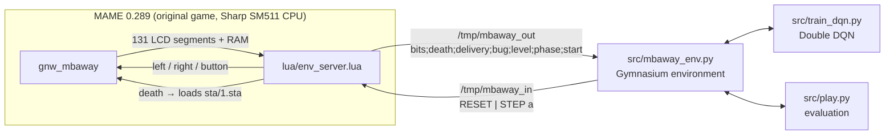

# Mario's Bombs Away: a Reinforcement Learning agent

A **Double DQN** agent that learned to play *Mario's Bombs Away* (Nintendo Game & Watch, 1983) on the original game, emulated in MAME. The network's inputs are the LCD screen segments and two internal variables from the chip's RAM.

The game was not reimplemented. The agent presses the same 3 buttons a human would (left, right, bomb) through a Lua script running inside MAME, which talks to Python over *named pipes*.

| | |
|---|---|
| Best recorded life | **44 bombs delivered** without dying (~10 min of play) |
| Evaluation average (ε = 0) | ~8–12 bombs per life (10-episode evaluations) |
| Network | MLP 38 → 128 → 128 → 4 (22,020 parameters) |
| Training | ~300k decisions, ~1 h 20 min on a MacBook M2 |

---

## Contents

1. [How it works](#1-how-it-works)
2. [The RL problem](#2-the-rl-problem)
3. [Folder structure](#3-folder-structure)
4. [Installation](#4-installation)
5. [Step by step](#5-step-by-step)
6. [How the hidden variables were found](#6-how-the-hidden-variables-were-found)
7. [Signal map (RAM and segments)](#7-signal-map)
8. [Configuration](#8-configuration)
9. [Results and training history](#9-results-and-training-history)
10. [Limitations and next steps](#10-limitations-and-next-steps)
11. [Troubleshooting](#11-troubleshooting)

---

## 1. How it works



Two processes run at the same time:

**MAME + `lua/env_server.lua`** (the environment "server"). Every frame, the script:
- reads the 131 LCD segments (`root:output(name)`) and a few addresses from the SM511's RAM;
- executes the received action for **8 frames** (*action repeat*, ~0.13 s of game time);
- detects **death**, **delivery** and the cutscene **bug**;
- on death, immediately loads the checkpoint `sta/gnw_mbaway/1.sta` (start of Game B, with a bomb in hand), in the same frame. This way Python doesn't waste time waiting for the animation;
- during the delivery animation (the game pauses and Mario walks back to the start) it skips frames on its own, up to `MAX_SKIP = 300`, so the agent doesn't "decide" at a moment when nothing responds;
- forces RAM `0x0B` to 3 every frame (fixed speed, see [section 6](#6-how-the-hidden-variables-were-found)).

**Python** (`src/`). `mbaway_env.py` wraps the protocol in a Gymnasium API (`reset`, `step`). `train_dqn.py` trains and `play.py` evaluates.

**Protocol** (text, one line per message):

| Direction | Message |
|---|---|
| Python → Lua | `RESET` or `STEP <0-3>` (0 nothing, 1 left, 2 right, 3 button) |
| Lua → Python | `<131 bits>;<death>;<delivery>;<bug>;<level 0x0B>;<phase 0x0C>;<start>` |

MAME has to start **first**: the Lua script creates the FIFOs and blocks until Python opens them.

---

## 2. The RL problem

**Episode = one life.** It starts at the Game B start checkpoint and ends with the first bomb that explodes in Mario's hands (the original game gives 3 lives; here there is only one). On `reset`, a random number (0 to 29) of "nothing" steps is taken, to shift the chip's timers out of phase so it doesn't always start from the same state.

**Observation: 38 values between 0 and 1.**
- **36 game segments** (`src/segments.py`): 15 torches, 10 Mario positions (2 columns × 5 rows), 4 for the cigar man, 5 ground fires and 2 for the man at the end. The 21 score segments, the digits and the rest of the decoration are left out.
- **Speed level**: RAM `0x0B`, normalized. With the fixed speed it's constant, but it stays in the input so the speed can be unlocked without changing the network.
- **Tick phase**: RAM `0x0C` / 5, how long until the game's next "tick". Without this the network sees the screen but doesn't know *when* the torches are going to move.

**Actions:** nothing, left, right and button (raises or lowers the bomb).

**Reward:** as little as possible.

| Event | Reward |
|---|---|
| Bomb delivered | +1 |
| Death | −1 (and end of episode) |
| Each decision (including standing still) | −0.01 |
| Potential-based *shaping* | γ·Φ(s') − Φ(s), with Φ = 0.05 × Mario's row (0..4) |

The *shaping* gives +0.05 for each row Mario moves forward and −0.05 for each row back. Because it's potential-based, it doesn't change the optimal policy (Ng, Harada & Russell, 1999); it only speeds up learning at the beginning. The −0.01 per decision never makes dying preferable: standing still forever is worth −1 in the limit, the same as dying, and the discount γ = 0.99 already favors quick deliveries. The game score and tree explosions are ignored.

**Algorithm:** Double DQN (`src/train_dqn.py`). The online network picks the best action for the next state and the *target* network evaluates it, which reduces the Q-value overestimation of plain DQN.

| Hyperparameter | Value |
|---|---|
| Network | MLP 38 → 128 → 128 → 4, ReLU |
| Replay buffer | 100,000 transitions |
| Batch | 64, one update per decision |
| Warmup | 5,000 transitions before training |
| Target sync | every 1,000 steps |
| Optimizer | Adam, lr 1e-4 (phase 1) |
| Loss | Smooth L1 (Huber), *gradient clipping* at 10 |
| γ | 0.99 |
| ε-greedy | 1.0 → 0.05 linear over 50,000 steps (phase 1); floor of 0.01 in phase 2 |

Two buffer rules that matter:
- **Truncating is not dying.** When an episode reaches the step limit (`MB_MAX_STEPS`), its transitions are stored with `done = False`. The network keeps estimating the value of the next state instead of learning that "the game ends there".
- **Episodes with the bug are discarded.** If segment `1.15.1` lights up, death detection failed and the cutscene started. That episode's transitions don't go into the buffer.

---

## 3. Folder structure

```
mame/
├── README.md
├── requirements.txt
├── .gitignore
│
├── lua/                      # scripts that run INSIDE MAME
│   ├── env_server.lua        #   the environment: actions, detection, resets, FIFOs (train and play)
│   ├── make_checkpoint.lua   #   creates sta/gnw_mbaway/1.sta (only needed once)
│   ├── dump_ram.lua          #   research: records segments + RAM every frame to a CSV
│   └── poke_speed.lua        #   research: forces 0x0B and measures the actual speed
│
├── src/                      # Python
│   ├── mbaway_env.py         #   Gymnasium environment (observation, reward, shaping)
│   ├── segments.py           #   LCD segment map (torches, Mario, ...)
│   ├── train_dqn.py          #   Double DQN training
│   └── play.py               #   greedy evaluation (ε = 0)
│
├── data/
│   └── segnames.json         # names of the 131 LCD segments, in protocol order
│
├── models/
│   ├── mario_dqn_final.pt    # final model (phase 2)
│   └── mario_dqn_fase1.pt    # phase 1 model (starting point for phase 2)
│
├── sta/gnw_mbaway/1.sta      # Game B start checkpoint (MAME save state)
│
├── research/                 # how 0x0B and 0x0C were found
│   ├── analyze_speed.py
│   ├── analyze_speed2.py
│   └── data/speed_session.csv
│
├── tests/
│   └── fake_mame.py          # tests the pipeline without MAME (real Lua in a simulated MAME)
│
├── roms/gnw_mbaway.zip       # the ROM, not included in the repository (copyright)
├── cfg/                      # generated by MAME
└── .venv/                    # Python environment
```

Checkpoints from a new training run go to `checkpoints/`, which is created automatically.

---

## 4. Installation

Tested on macOS (Apple Silicon), MAME 0.289, Python 3.14 and PyTorch 2.14.

```bash
# 1. MAME
brew install mame

# 2. ROM: copy your gnw_mbaway.zip (MAME romset) to roms/

# 3. Python
cd ~/mame
python3 -m venv .venv
source .venv/bin/activate
pip install -r requirements.txt
```

The network is small and the bottleneck is the emulator, so it trains on the CPU (MPS or CUDA isn't worth it).

---

## 5. Step by step

All commands are run **from the project folder** (`~/mame`), because the Lua scripts use paths relative to it.

### 5.1 Game B start checkpoint (already included)

`sta/gnw_mbaway/1.sta` already ships with the project. You only need this if you want to regenerate it (warning: it overwrites the file):

```bash
mame gnw_mbaway -autoboot_script lua/make_checkpoint.lua -autoboot_delay 3 -window
```

In MAME, press **Game B** and play. The script saves the state on the 3rd falling edge of segment `1.0.2`, i.e. when Mario receives the bomb for the 3rd time (game running, bomb in hand). After that it freezes and doesn't save again.

### 5.2 Train from scratch

Terminal 1 (MAME first; the window stays frozen until Python connects):

```bash
mame gnw_mbaway -autoboot_script lua/env_server.lua -autoboot_delay 0 \
     -window -nothrottle -sound none
```

Terminal 2:

```bash
source .venv/bin/activate
python src/train_dqn.py                    # 300,000 steps by default
```

`-nothrottle` makes MAME run as fast as possible: ~64 decisions/s, ~26 min per 100,000 steps on an M2.

Every 10 episodes a line like this is printed:

```
ep  3500 | step  198133 | eps 0.050 | entregas inicio(50) 2.30 | melhor 2.30 | ...
```

`entregas inicio(50)` is the average number of bombs delivered per life over the last 50 episodes, still with ε exploration. `best.pt` is saved whenever that average beats the record (`melhor`). Every 5,000 steps the action distribution is printed too.

Files in `checkpoints/`: `best.pt`, `latest.pt`, `ckpt_<step>.pt` (every 10,000) and `final.pt`.

### 5.3 Resume training from a model

The model also stores the optimizer state, so training can be resumed. The buffer starts empty again.

```bash
MB_RESUME=models/mario_dqn_final.pt MB_CKPT_DIR=checkpoints_fase3 \
MB_EPS_START=0.01 MB_EPS_END=0.003 MB_EPS_DECAY=50000 \
MB_LR=3e-5 MB_STEPS=100000 python src/train_dqn.py
```

Phase 2 was done this way, starting from `mario_dqn_fase1.pt`, with the ε floor at 0.01.

### 5.4 Evaluate / watch it play

To **watch** it play at real speed, run MAME without `-nothrottle`:

```bash
mame gnw_mbaway -autoboot_script lua/env_server.lua -autoboot_delay 0 -window
```

To **measure**, use `-nothrottle` and at least 30 episodes:

```bash
MB_EP=30 python src/play.py                          # final model
MB_EP=30 python src/play.py models/mario_dqn_fase1.pt
```

At the end it prints the average deliveries per episode, the standard deviation (`desvio`) and the standard error (`erro tipico`):

```
MEDIA: 9.80 entregas/episodio em 30 episodios (desvio ..., erro tipico ...) -> p por bomba ~ 0.91
```

`p por bomba` is the estimated probability of delivering each bomb. If each bomb is delivered with probability p, the average number of deliveries per life is p / (1 − p). An average of 50 requires p ≈ 0.98.

With ε = 0 the policy is deterministic. The only variety between episodes comes from the 0–29 "nothing" steps on reset, so repeated episodes can show up.

### 5.5 Test without MAME

```bash
pip install lupa
python tests/fake_mame.py train     # short training run against env_server.lua in a fake MAME
python tests/fake_mame.py play      # evaluates the final model in the fake MAME
```

This runs the real `lua/env_server.lua` in a Lua interpreter with a simulated MAME, over the same FIFOs. Use it to confirm that the protocol, resets, training and play still work after changing the code. The numbers it prints are meaningless.

---

## 6. How the hidden variables were found

The screen doesn't show everything. The game has a speed that changes (it speeds up with deliveries) and an internal clock that decides *when* the torches and fires advance. Without that information the network sees a snapshot and doesn't know how much time it has. The process was:

1. **Record.** `lua/dump_ram.lua` records the 131 segments and the SM511's 128 RAM addresses to a CSV every frame, while you play by hand.
   ```bash
   mame gnw_mbaway -autoboot_script lua/dump_ram.lua -autoboot_delay 0 -window
   ```
2. **Look for candidates.** The first attempt was automatic, with the scripts in `research/` (they need `pandas`):
   - `analyze_speed.py` measures the interval between torch movements and looks for the address that explains it;
   - `analyze_speed2.py` looks for addresses that change rarely, close to deliveries, and that track the number of deliveries in the current life.

   ```bash
   python research/analyze_speed2.py research/data/speed_session.csv
   ```

   **They were inconclusive.** Torch blinking counted as movement, and with few deliveries per session the correlation points at the wrong addresses (in the included CSV, `0x0B` doesn't show up at the top). `0x0B` was found by looking at the CSV directly: it's the address that steps down (5 → 4 → 3) exactly at the end of a delivery animation and stays constant between deliveries. From there, `0x0C` turned up as the counter that goes down from `0x0B` to 0 between two ticks.
3. **Prove causation.** Correlation isn't enough. `lua/poke_speed.lua` writes a value to `0x0B` every frame and measures the tick interval. With `0x0B = 3` the tick went from ~28 to ~18 frames and the game became visibly faster, which proves that `0x0B` *controls* the speed.

Result:
- `0x0B` = **speed level**. It's 5 at the start (slow, ~28-frame tick), 4 gives ~23 and 3 gives ~18; lower is faster. It only changes at the end of the delivery animation.
- `0x0C` = **tick phase**. Counts down from `0x0B` to 0 between two ticks (~5 frames per unit).

**Decision:** the speed was fixed at 3 (`FORCE_NIVEL = 3` in `env_server.lua`). This removes the part of the problem that comes from the game speeding up and leaves only "play well at a fast speed". With `FORCE_NIVEL = nil` the speed is free and the Lua script saves an `lv<N>` checkpoint the first time each level appears. Resets then pick at random between the start and those levels, but this mode was not used for the final model.

The **torch timer** is still unidentified. The fires line up with the tick counter `0x09` in 80–91% of cases, but the torches only in 29%, so there's another clock the network can't see.

---

## 7. Signal map

**RAM (SM511, 4 bits per address):**

| Address | Meaning | Use |
|---|---|---|
| `0x0B` | speed level (5 slow … 1 fast) | network input; forced to 3 |
| `0x0C` | tick phase (counts down from `0x0B` to 0) | network input |
| `0x2C` | becomes 15 on death (~6 frames before the animation) | death detection |
| `0x5A` | delivery animation counter (0 = finished) | per-level checkpoints |
| `0x09` | tick counter | research |
| `0x02` | 0–9 counter (wraps around after 6 deliveries) | unused |
| `0x03` | step counter | unused |
| `0x1B`, `0x4E`, `0x4F`, `0x18`, `0x19` | periodic clocks | unused |

**Control segments:**

| Segment | Meaning |
|---|---|
| `1.8.0` + `0.8.1` | delivery (Mario in the last position + the man at the end) |
| `0.10.0` (turns on) | delivery confirmed → the game pauses (`game_stopped`) |
| `1.0.2` (turns off) | Mario receives a new bomb → the game resumes |
| `1.15.1` | death cutscene: detection failed, the episode is discarded |

The 36 observation segments are listed in `src/segments.py`.

---

## 8. Configuration

**Python** (environment variables, all optional):

| Variable | Default | What it does |
|---|---|---|
| `MB_STEPS` | 300000 | training steps (decisions) |
| `MB_LR` | 1e-4 | learning rate |
| `MB_EPS_START` / `MB_EPS_END` / `MB_EPS_DECAY` | 1.0 / 0.05 / 50000 | ε-greedy exploration |
| `MB_WARMUP` | 5000 | transitions before training starts |
| `MB_MAX_STEPS` | 5000 (training), 20000 (play) | step limit per episode |
| `MB_FRAME_STACK` | 1 | how many consecutive screens the network sees (4 → 146 inputs) |
| `MB_SHAPING` | 0.05 | weight of the position shaping (0 turns it off) |
| `MB_CKPT_DIR` | `checkpoints` | where to save models |
| `MB_RESUME` | — | model to resume from |
| `MB_EP` | 10 | number of `play.py` episodes |
| `MB_SEGNAMES` | `data/segnames.json` | segment list |

`MB_FRAME_STACK` and `MB_SHAPING` change the observation or the reward: you can't resume a model that was trained with different values.

**Lua** (top of `lua/env_server.lua`):

| Constant | Value | What it does |
|---|---|---|
| `FORCE_NIVEL` | 3 | fixed speed; `nil` frees it |
| `ACTION_REPEAT` | 8 | frames per decision |
| `MAX_SKIP` | 300 | maximum frames skipped during the delivery animation |
| `LOAD_FRAMES` | 12 | frames to wait after loading a checkpoint |
| `P_INICIO` | 0.5 | free speed only: probability that a reset goes to the start |

---

## 9. Results and training history

| Phase | Model | Steps | What changed | Training average (50 ep., with ε) |
|---|---|---|---|---|
| 1 | `mario_dqn_fase1.pt` | 198,133 (of 210,000) | trained from scratch, final ε 0.05 | ~2.3 |
| 2 | `mario_dqn_final.pt` | +98,542 (of 100,000) | resumed from phase 1, ε floor 0.01 | 5.38 |

Greedy evaluation (ε = 0) of the final model gives ~8–12 bombs per life, with a long tail: the best recorded episode had **44 deliveries**, ~10 min of play. An average of ~10 corresponds to p ≈ 0.91 per bomb. An evaluation with `MB_EP=30` is still needed to get clean error bars.

The gap between training and evaluation is expected: with ε = 0.05, 1 in every 20 decisions is random, and over a life of hundreds of decisions that's enough to die.

What made a difference, in order:
1. **Clean death and delivery detection** in Lua, with the reset on the very frame of the death. The first versions missed deaths, and the agent learned from wrong episodes.
2. **Fixing the speed and giving the tick phase (`0x0C`) to the network.** Without the phase the network doesn't know *when* the danger arrives.
3. **Lowering the exploration floor** from 0.05 to 0.01 in phase 2: the training average went from ~2.2 to ~4–5.
4. **Not discarding truncated episodes.** An old version threw away the episodes that reached the 2000-step limit, i.e. precisely the best ones. This is fixed in the current `train_dqn.py`. Both included models were trained *before* this fix, so there's room for improvement.

---

## 10. Limitations and next steps

- **Only one life, and speed fixed at 3.** The full game has 3 lives and speeds up.
- **Torch timer still unidentified** (see [section 6](#6-how-the-hidden-variables-were-found)). It's probably the missing information needed to go from p ≈ 0.91 to p ≈ 0.98.
- **Episodes with the bug are discarded** entirely. It would be better to keep the transitions up to shortly before `1.15.1` and mark it as a death.
- **Evaluation with 30+ episodes and several seeds** to compare models rigorously.

Experiment ideas:
- tabular Q-learning on the same observation;
- DQN vs Double DQN;
- DQN on the full RAM, with *permutation importance*, to see which variables the network actually uses (it might reveal the torch timer);
- `MB_FRAME_STACK=4` and a recurrent network;
- CNN on the screen image (~150×100).

---

## 11. Troubleshooting

| Symptom | Cause / fix |
|---|---|
| The MAME window freezes, or Python hangs on startup | normal until both are connected through the FIFOs: start MAME first, then Python |
| `RuntimeError: resposta com N campos (esperava 7)` (response has N fields, expected 7) | MAME is running a different Lua script, or an old `env_server.lua` |
| `FileNotFoundError: data/segnames.json` (in MAME) | `mame` wasn't launched from the project folder |
| `assert ... n_in/mascara` when resuming | the model was trained with a different `MB_FRAME_STACK` or a different segment list |
| Deaths without a reset / frequent `!! BUG` | `-autoboot_delay` must be 0 (with a delay, segment edges are missed) |
| `source .venv/bin/activate` doesn't activate anything | the venv was created in another folder: delete `.venv` and create it again (section 4) |
| Leftover stuck processes | close MAME, `rm -f /tmp/mbaway_in /tmp/mbaway_out`, and start again |
